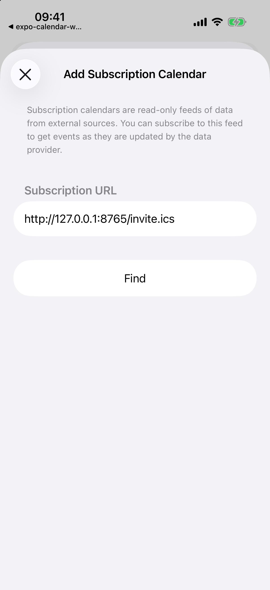
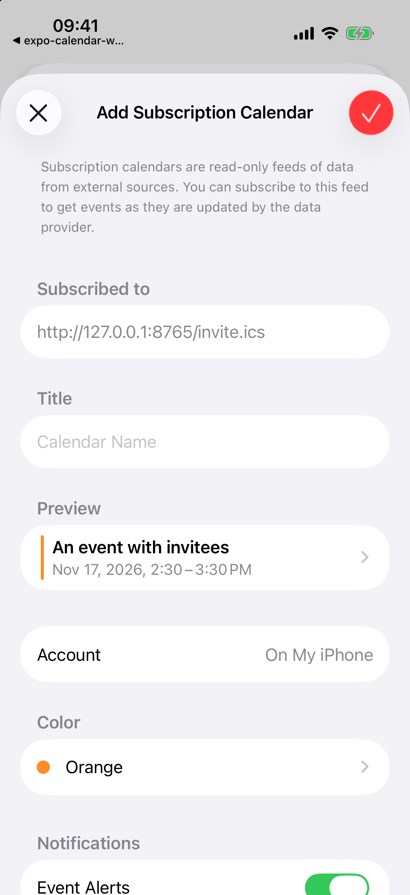

# expo-calendar: `getAttendees()` returns attendees with no properties on iOS (class-based API)

Reproduction for https://github.com/expo/expo/issues/53469.

Versions: Expo SDK 58, `expo-calendar` 58.0.6, React Native 0.88, iOS 26.5 simulator (iPhone 17),
Xcode 27.2.

## Result

Same event, same three invitees, read with both APIs on iOS:

| Class-based `event.getAttendees()` | Legacy `getAttendeesForEventAsync(event.id)` |
| --- | --- |
|  |  |

Full screen: [media/ios-result.png](media/ios-result.png).

| | `name` | `role` | `status` | `type` | `url` | `isCurrentUser` |
| --- | --- | --- | --- | --- | --- | --- |
| class API, each of 3 objects | undefined | undefined | undefined | undefined | undefined | undefined |
| legacy, Alice Attendee | "Alice Attendee" | required | accepted | person | mailto:alice@example.com | false |
| legacy, Bob Optional | "Bob Optional" | optional | tentative | person | mailto:bob@example.com | false |
| legacy, Room 4 | "Room 4" | notParticipant | pending | resource | mailto:room4@example.com | false |

The class-API objects have no own keys at all; their prototype has only `constructor` and
`__native_constructor__`. So the call succeeds and returns one object per attendee, but nothing can
be read from them.

## Run

```sh
npm install
npx expo run:ios      # development build, iOS simulator (the class API is not in Expo Go)
```

Grant calendar access when asked. The app lists every event in the next 14 days and, for each,
prints what `event.getAttendees()` and the legacy `getAttendeesForEventAsync(event.id)` return.
**run again** repeats it.

## Getting an event with invitees into the simulator

EventKit cannot add attendees to an event, so the app cannot create one. A subscribed calendar
can carry them. `scripts/invite.ics` is a one-event feed with an organizer and three `ATTENDEE`
lines (required, optional, and a room resource).

1. `scripts/serve-invite.sh` serves it on `http://127.0.0.1:8765/invite.ics` (the simulator
   shares the Mac's loopback interface).
2. `xcrun simctl openurl booted http://127.0.0.1:8765/invite.ics` opens Calendar's
   **Add Subscription Calendar** sheet.
3. Tap **Find**, **Continue** on the insecure-connection prompt, then the check mark. Dismiss the
   location and notification prompts Calendar shows the first time.
4. Open the repro app and tap **run again**.

| Step 2: the sheet | Step 3: the feed parsed, the event previewed |
| --- | --- |
|  |  |

Xcode 27 shows simulators in DeviceHub, which ignores AppleScript clicks. `scripts/sim-click.py`
posts real mouse events at screenshot coordinates so the taps above can be scripted; it needs
`pip install pyobjc-framework-Quartz` and Accessibility access for the terminal.

## Cause

`packages/expo-calendar/ios/Next/CalendarNextModule.swift` registers the attendee class with an
empty definition:

```swift
// Available only on Android
Class(ExpoCalendarAttendee.self) {}
```

while the same file keeps `AsyncFunction("getAttendees")` on iOS and
`ios/Next/ExpoCalendarEvent.swift` wraps each `EKParticipant` in an `ExpoCalendarAttendee`. With
no `Property` definitions the shared object reaches JavaScript with nothing on it. Android's
`CalendarNextModule.kt` defines `id`, `name`, `role`, `status`, `type` and the rest. The legacy
iOS path serializes the same `EKParticipant` in `ios/Conversions/Conversions.swift` with
`isCurrentUser`, `name`, `role`, `status`, `type` and `url`, which is what the right column above
shows.

The TypeScript docs disagree with each other: in `src/ExpoCalendar.types.ts` the
`ExpoCalendarAttendee` class is marked `@platform android`, its `isCurrentUser` and `url` fields are
marked `@platform ios`, and `getAttendees()` carries no platform note.

Checked against `expo/expo` main on 11/15/26: the attendee class registration is unchanged.

## Expected

On iOS the class-based attendee objects expose the fields the legacy serializer returns (`name`,
`role`, `status`, `type`, `url`, `isCurrentUser`), or `getAttendees()` is documented as
Android-only. Creating attendees stays Android-only either way, since EventKit has no API for it.
